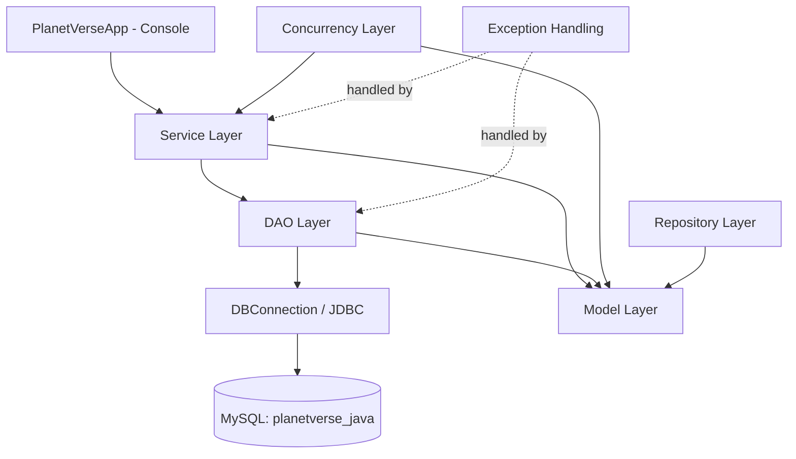

# PlanetVerse-Java Architecture

## High-level architecture

## Layers and responsibilities

| Layer / package | Responsibility | Key classes |
|---|---|---|
| `main` | Console entry point and test programs | `PlanetVerseApp` |
| `model` | Represents students, courses and enrollments | `User`, `Student`, `Instructor`, `Course`, `Enrollment`, `Eligible`, `EnrollmentStatus` |
| `service` | Business operations and coordination | `CourseService`, `StudentService` |
| `dao` | Database access | `StudentDAO`, `CourseDAO`, `EnrollmentDAO`, `TransactionalEnrollmentDAO` |
| `database` | JDBC connection creation | `DBConnection` |
| `concurrency` | Concurrent enrollment/task processing | `SlotManager`, `EnrollmentTask`, `EnrollmentRequestQueue`, `EnrollmentProducer`, `EnrollmentConsumer`, `EnrollmentCallable`, `EnrollmentExecutor` |
| `repository` | Repository contracts and in-memory student storage | `Repository`, `StudentRepository`, `InMemoryStudentRepository` |
| `exception` | Application-specific exceptions | `DuplicateStudentException`, `StudentNotFoundException`, `EnrollmentException` |
| `util` | Input validation and utilities | `InputValidator` |

## Main database flow

1. `PlanetVerseApp` receives console input.
2. The app calls service methods for operations.
3. Service classes apply business rules and coordinate DAO operations.
4. DAO classes use JDBC and `PreparedStatement` to communicate with MySQL.
5. Retrieved database records are mapped into model objects.
6. Expected errors are handled using validation and exception handling.

## Concurrency flow

Concurrency utilities submit or queue enrollment work. Shared queue operations are coordinated by synchronization, and capacity reservations are protected by `SlotManager`/semaphore logic. Database enrollment is also handled by the transactional enrollment DAO.

> This document describes the project's current architecture at a high level. Confirm individual dependencies against source code before treating this diagram as a complete class-level UML diagram.
