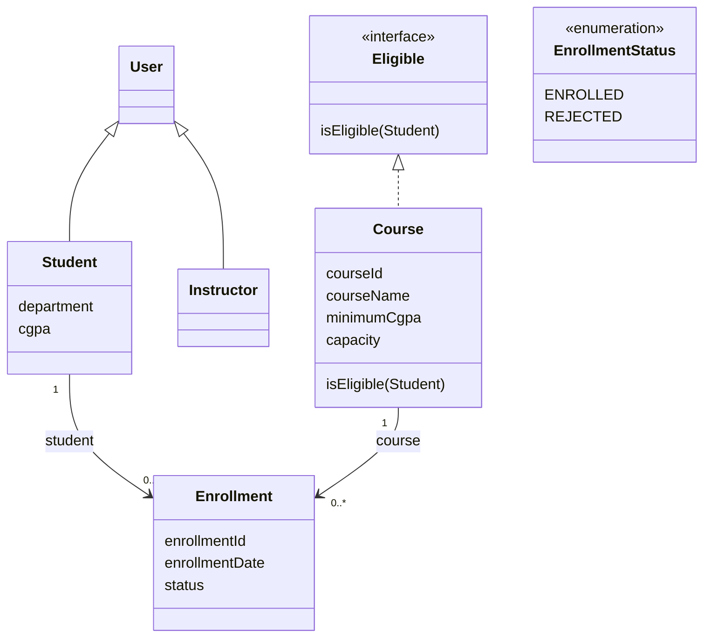
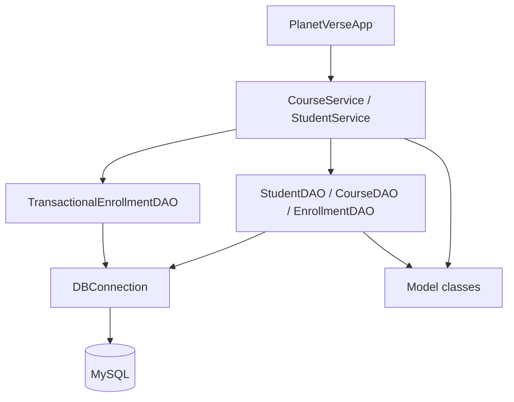

# PlanetVerse-Java — UML Class Diagram (Draft)

This diagram is based on the class names and relationships confirmed so far. Verify remaining method-level details against the source before using it as a definitive UML diagram.

## Core domain classes

- **User:** Shared superclass for user-related properties.
- **Student:** Student record; extends `User`.
- **Instructor:** Extends `User` (as reflected in the project's current model).
- **Eligible:** Eligibility-check contract.
- **Course:** Course information and eligibility logic.
- **Enrollment:** Represents a student's enrollment in a course.
- **EnrollmentStatus:** Enrollment state values.

## Layer-level relationships (overview)

## Notes

- The domain diagram shows relationships that have been confirmed in prior code discussions.
- The layer-level diagram is an overview; exact dependencies should be checked against imports and method calls.
- This draft intentionally avoids inventing method signatures or composition relationships that have not been verified.
